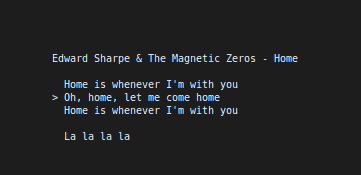
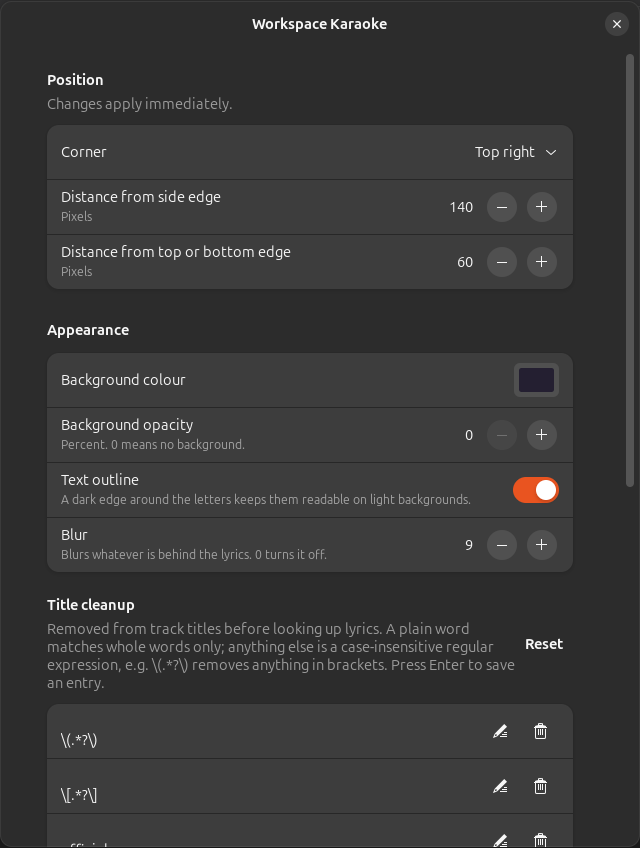

# workspace-karaoke

Synced lyrics for whatever is playing, overlaid on the GNOME desktop.



Works with any MPRIS media player (Firefox, Chrome, Spotify, …). Lyrics come from [lrclib.net](https://lrclib.net); the current track's artist and title are sent there to look them up. Nothing else to install or run.

Turn lyrics on and off with the **Lyrics** button in Quick Settings (top-right menu).

## Settings

Open the Extensions app → Workspace Karaoke → settings. Every change applies immediately.



| Option | What it does | Default |
| --- | --- | --- |
| Corner | Screen corner the lyrics sit in | Top right |
| Distance from side edge | Gap from the left or right edge, in pixels | 240 |
| Distance from top or bottom edge | Gap from the top or bottom edge, in pixels | 60 |
| Background colour | Colour of the panel behind the lyrics | Black |
| Background opacity | How solid that panel is, in percent; 0 hides it | 35 |
| Text outline | Dark edge around the letters, so lyrics stay readable on white windows | On |
| Blur | Blurs whatever is behind the lyrics; 0 turns it off | 20 |
| Title cleanup | Words and regexes stripped from track titles before the lyrics lookup. A plain word matches whole words only (`hd` leaves "Shadow" alone); anything else is a case-insensitive regex, e.g. `\(.*?\)` removes anything in brackets. | Brackets, "official", "video", "audio", "lyrics", "hd", "4k", "remastered", … |

## Install from source (GNOME 46)

```sh
git clone https://github.com/zenoweed/workspace-karaoke
cd workspace-karaoke/src/workspace-karaoke@zenoweed.github.io
glib-compile-schemas schemas
ln -s "$PWD" ~/.local/share/gnome-shell/extensions/workspace-karaoke@zenoweed.github.io
# log out and back in (Wayland), then:
gnome-extensions enable workspace-karaoke@zenoweed.github.io
```

If lyrics are out of sync, pause and resume once. Firefox (and Zen) only report the playback position after a track has been played, paused or seeked, and a YouTube autoplay track hasn't been. Until then the extension counts time itself from when it first sees the track.

## Test

```sh
glib-compile-schemas src/workspace-karaoke@zenoweed.github.io/schemas
gjs -m tests/lyrics.test.js
```

## Package for extensions.gnome.org

```sh
gnome-extensions pack src/workspace-karaoke@zenoweed.github.io --extra-source=lyrics.js --schema=schemas/org.gnome.shell.extensions.workspace-karaoke.gschema.xml
```
